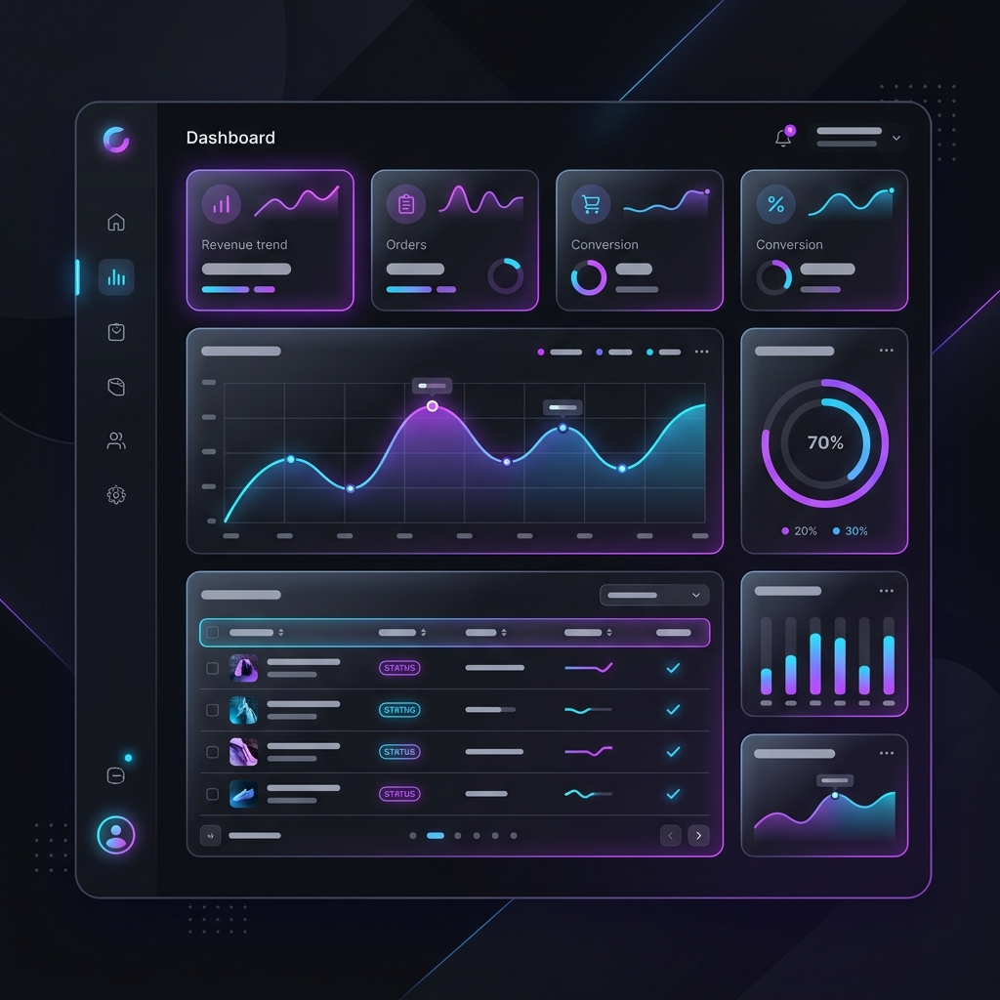

<div align="center">
  

  <h1>🚀 Premium Geliştirici Portfolyo Şablonu</h1>
  <p>Modern, karanlık tema odaklı ve tamamen özelleştirilebilir açık kaynak portfolyo şablonu.</p>

  <div>
    
    
    
    
  </div>
</div>

<br />

Önde gelen teknoloji devlerinin (Linear, Vercel, Stripe) tasarım dillerinden ilham alınarak hazırlanmış bu şablon; **minimalist bir estetiği**, **cam efektlerini (glassmorphism)** ve **pürüzsüz animasyonları** tek bir yerde buluşturuyor.

---

## ✨ Neden Bu Şablon?

Sıradan, herkesin kullandığı sıkıcı portfolyolardan sıkıldınız mı? Bu şablon size şunları sunar:
- 🎨 **Premium Karanlık Tema:** Göz yormayan, kod editörü hissi veren derin siyah (`#010102`) arkaplan.
- ⚡ **İnanılmaz Hızlı:** Vite ve React ile sıfır gecikme, anında yüklenen sayfalar.
- 🎬 **Akıcı Animasyonlar:** Sayfa kaydırıldıkça (scroll) yağ gibi akan Framer Motion mikro-animasyonları.
- 🛠 **Merkezi Veri Yönetimi:** Koda dokunmadan sadece **tek bir dosyayı** (`data.ts`) düzenleyerek tüm siteyi kendinize göre ayarlayabilme.
- 📱 **%100 Mobil Uyumlu:** Telefondan tablete her ekranda kusursuz görünüm.

---

## 🚀 Hızlı Başlangıç

Projeyi bilgisayarınıza indirip hemen çalıştırmak için aşağıdaki adımları izleyin:

**1. Projeyi Klonlayın (İndirin)**
```bash
git clone https://github.com/7EMRE1905/premium-portfolio-template.git
cd premium-portfolio-template
```

**2. Gerekli Paketleri Yükleyin**
```bash
npm install
```

**3. Geliştirici Sunucusunu Başlatın**
```bash
npm run dev
```
Tarayıcınızda `http://localhost:5173` adresine giderek portfolyonuzu canlı olarak görebilirsiniz!

---

## ⚙️ Nasıl Özelleştirilir? (Kendi Portfolyonuz Yapın)

Kodların arasında kaybolmanıza gerek yok! Sitenin içeriğini değiştirmek için tek yapmanız gereken **`src/data.ts`** dosyasını açmaktır.

Bu dosyanın içinde tüm bilgileriniz modüler olarak durur:
- **`personal`**: İsminiz, mesleğiniz ve biyografiniz.
- **`social`**: Sosyal medya (GitHub, Twitter, LinkedIn) linkleriniz.
- **`skills`**: Kullandığınız teknolojiler ve ikonları.
- **`projects`**: Sergilemek istediğiniz projelerin adı, resmi, açıklaması ve linkleri.
- **`experience`**: Eğitim veya kariyer geçmişiniz (Zaman çizelgesi olarak ekranda görünür).

`data.ts` dosyasını kendi bilgilerinize göre doldurup kaydettiğiniz an, tüm site otomatik olarak sizin portfolyonuz haline gelir!

---

## 📂 Klasör Yapısı

Projeye katkıda bulunmak veya kodları incelemek isteyenler için kısa bir rehber:

```text
📦 premium-portfolio-template
 ┣ 📂 public/            # Görseller ve ikonlar
 ┣ 📂 src/
 ┃ ┣ 📜 App.tsx          # Ana React bileşeni (Arayüz kodları)
 ┃ ┣ 📜 index.css        # Tüm premium renk paleti ve CSS kodları
 ┃ ┣ 📜 data.ts          # Sitenin tüm İÇERİĞİNİ barındıran veri dosyası
 ┃ ┗ 📜 main.tsx         # Uygulama başlangıç noktası
 ┣ 📜 index.html         # SEO ve meta etiketlerinin olduğu dosya
 ┗ 📜 package.json       # Proje bağımlılıkları
```

---

## 🤝 Katkıda Bulunma (Contributing)

Bu proje tamamen açık kaynaktır! Tasarımı daha da iyileştirecek veya yeni özellikler ekleyecek her türlü Pull Request (PR) başımızın tacıdır.
1. Projeyi Fork'layın
2. Yeni bir dal (branch) oluşturun (`git checkout -b ozellik/YeniHarikaOzellik`)
3. Değişikliklerinizi commit'leyin (`git commit -m 'Yeni bir harika özellik eklendi'`)
4. Dalınıza push yapın (`git push origin ozellik/YeniHarikaOzellik`)
5. Bir Pull Request açın!

---

## 📄 Lisans

Bu proje **MIT Lisansı** ile lisanslanmıştır. Dilediğiniz gibi kullanabilir, değiştirebilir ve kendi projelerinizde (ticari dahil) herhangi bir kısıtlama olmadan kullanabilirsiniz. 

<br/>
<div align="center">
  <b>Yusuf Emre</b> tarafından kodlanmıştır.
</div>
